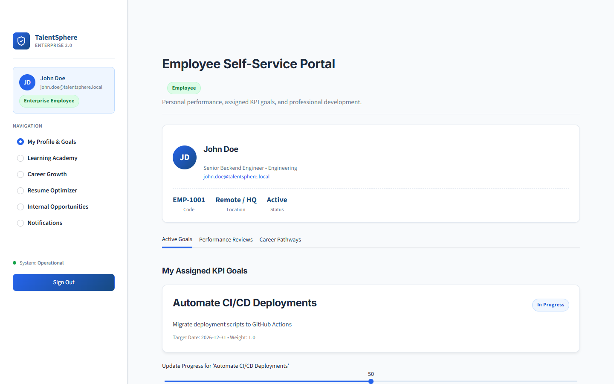
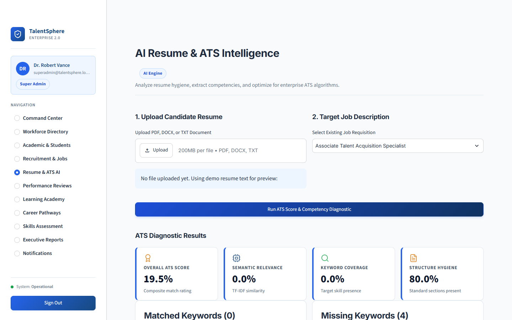
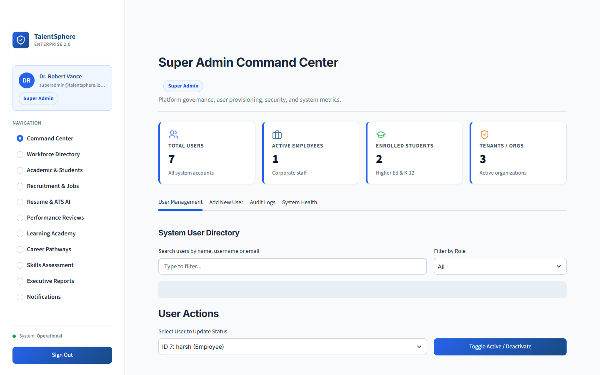
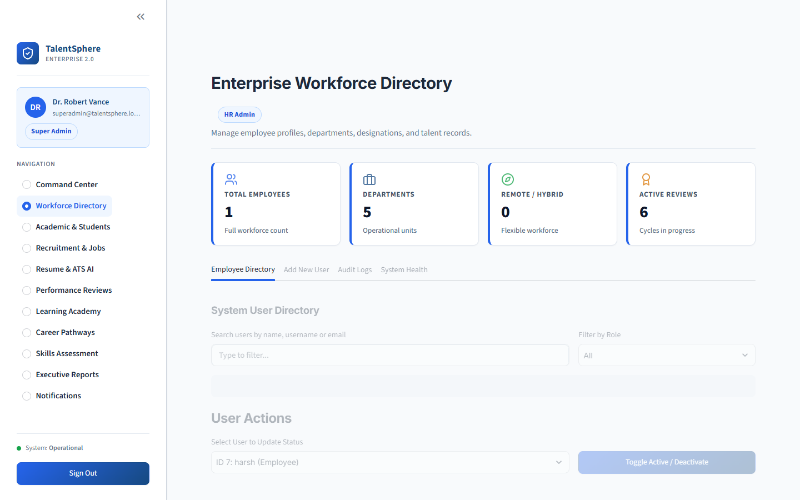
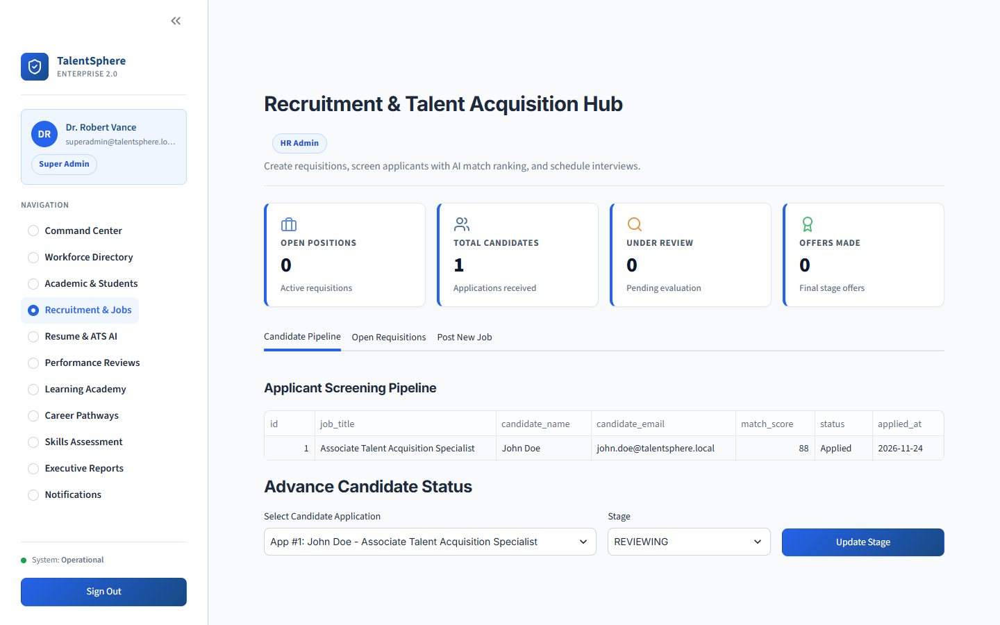
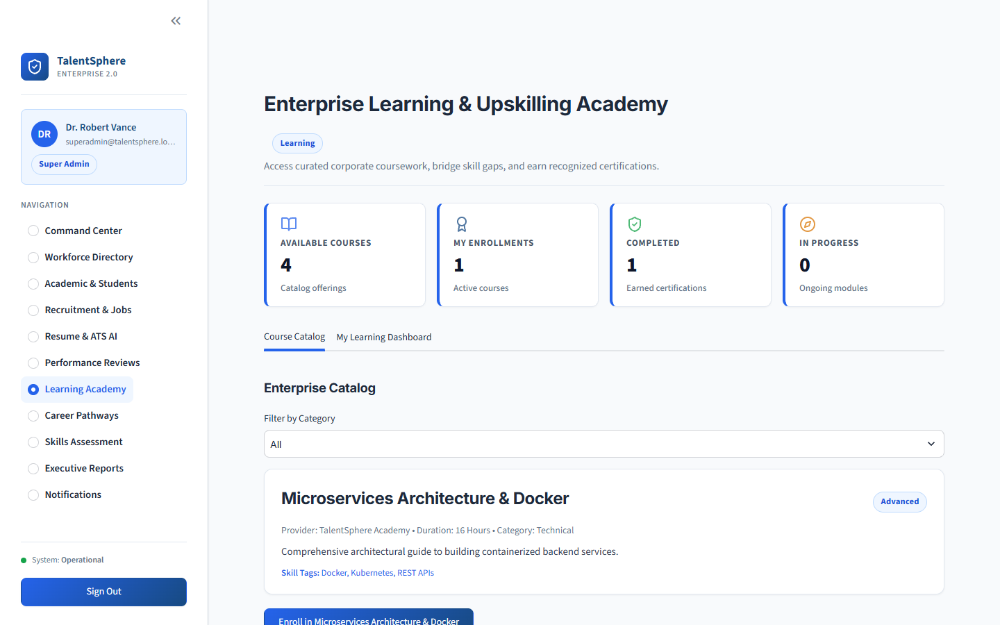

# TalentSphere Enterprise 2.0
> **AI-Powered Talent Management Platform for Employee Performance and Career Growth**

[](https://talentsphereenterprise20-hq239uebmxwggycjex9icv.streamlit.app/)
[](LICENSE)
[](tests/)

🌐 **Live Production Website**: [https://talentsphereenterprise20-hq239uebmxwggycjex9icv.streamlit.app/](https://talentsphereenterprise20-hq239uebmxwggycjex9icv.streamlit.app/)

TalentSphere Enterprise 2.0 is an enterprise-grade, multi-tenant talent management platform developed from scratch. It unifies corporate human capital management, academic student placement readiness, AI resume & ATS diagnostics, skills assessments, and career coaching into a single light-blue + white themed SaaS architecture.

---

## 📸 Live Application Showcase

| Employee Self-Service & Goals | AI Resume & ATS Diagnostics |
|:---:|:---:|
|  |  |

| Super Admin Command Center | Workforce Directory |
|:---:|:---:|
|  |  |

| Recruitment & Pipeline Hub | Learning Academy |
|:---:|:---:|
|  |  |

---

## 🚀 Key Features & Capabilities

- **6 Distinct User Roles**:
  - `Super Admin`: Platform governance, user provisioning, security, and audit logs.
  - `HR Admin`: Workforce directory, KPI performance reviews, job requisitions, and candidate pipelines.
  - `College Admin`: Student academic records, department analytics, and placement readiness tracking.
  - `Employee`: Self-service profile, assigned quarterly goals, review history, and career pathways.
  - `College Student`: Placement radar, practice assessments, ATS resume builder, and job applications.
  - `High School Student`: Holland Code (RIASEC) career explorer, pre-college majors, and foundational skill guides.

- **AI Engine & NLP Intelligence**:
  - **Resume Parser**: PDF/DOCX text extraction, contact info extraction, and skill taxonomy matching.
  - **ATS Scoring Engine**: Multi-factor scoring (Cosine similarity, keyword coverage, structural hygiene, readability).
  - **TF-IDF Job Matcher**: Candidate ranking against open job requisitions.
  - **Skill Gap Analyzer**: Gap diagnosis against target role competencies.
  - **AI Career Coach**: 90-day milestone-driven growth plans.

- **Enterprise Reporting**:
  - High-resolution ReportLab PDF reports for workforce directories and placement intelligence.
  - One-click CSV exports for HRIS and accreditation compliance.

---

## 🛠️ Technology Stack

| Layer | Technologies |
|---|---|
| **Frontend** | Streamlit, Custom Responsive CSS (Light Blue + White), Plotly, Lucide SVG Icons |
| **Backend** | Python 3.12+, SQLAlchemy ORM (28 entities), Pydantic v2 |
| **Database** | SQLite (WAL mode, zero lock contention for dev) / PostgreSQL (production) |
| **Security** | Bcrypt 12-round password hashing, Role-Based Access Control (RBAC) |
| **AI / NLP** | Scikit-learn (TF-IDF, Cosine Similarity), PyPDF, python-docx |
| **Reporting** | ReportLab PDF engine, Pandas |
| **DevOps** | Docker, Docker Compose, Healthcheck Probes |

---

## ⚡ Quick Start: Local Development

### 1. Prerequisites
- Python 3.11+
- Virtual environment tool (`venv`)

### 2. Setup Virtual Environment & Install Dependencies
```powershell
cd TalentSphere_Enterprise_2.0
python -m venv .venv
.\.venv\Scripts\Activate.ps1
pip install -r requirements.txt
```

### 3. Initialize & Seed Database
```powershell
python scripts/seed_database.py
```

### 4. Run Application
```powershell
streamlit run app.py
```
Access the application at `http://localhost:8501`.

---

## 🔐 Default Demo Accounts

| Role | Username | Password |
|---|---|---|
| **Super Admin** | `superadmin` | `SuperAdmin@2026` |
| **HR Admin** | `hr_admin` | `HRAdmin@2026` |
| **College Admin** | `college_admin` | `CollegeAdmin@2026` |
| **Employee** | `john_employee` | `Employee@2026` |
| **College Student** | `alex_student` | `Student@2026` |
| **High School Student** | `emma_hs` | `HighSchool@2026` |

---

## 🐳 Docker Deployment

### Run with Docker Compose:
```bash
docker-compose up --build -d
```

### Check Container Health:
```bash
docker ps
python healthcheck.py
```

---

## 🧪 Automated Testing

Execute the complete pytest test suite:
```powershell
.\.venv\Scripts\python.exe -m pytest -v
```

---

## 📄 License
MIT License - see [LICENSE](LICENSE) for full details. Copyright (c) 2026 Harsh Sharma.
